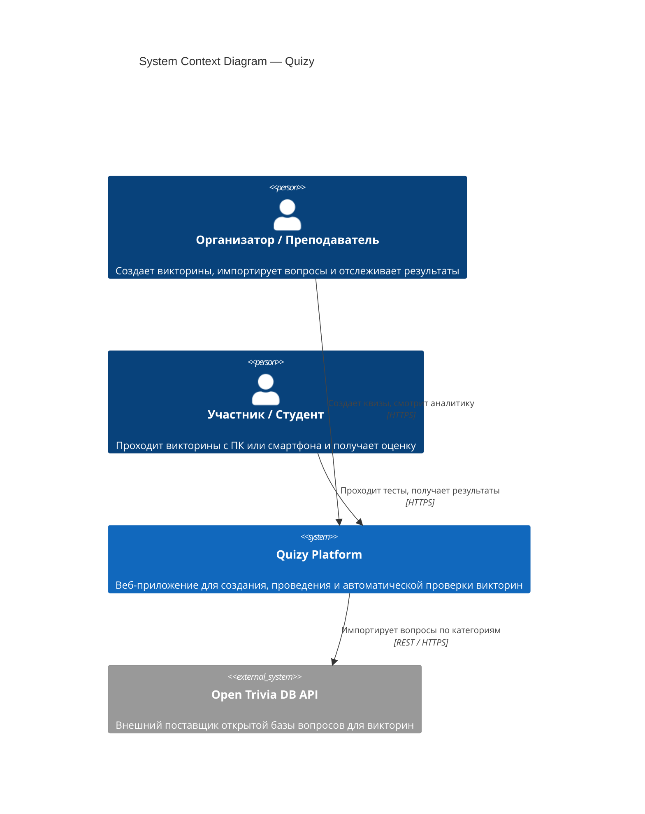
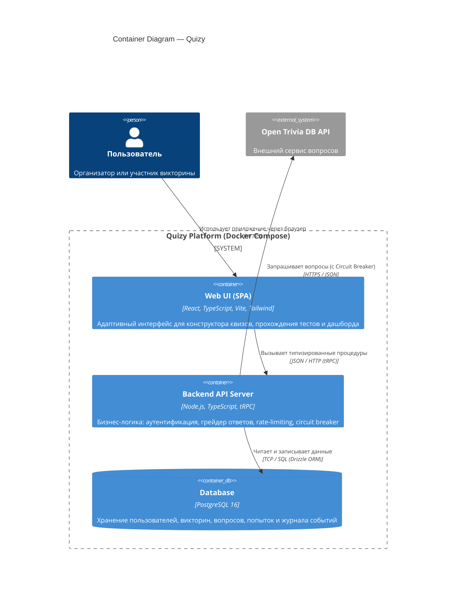
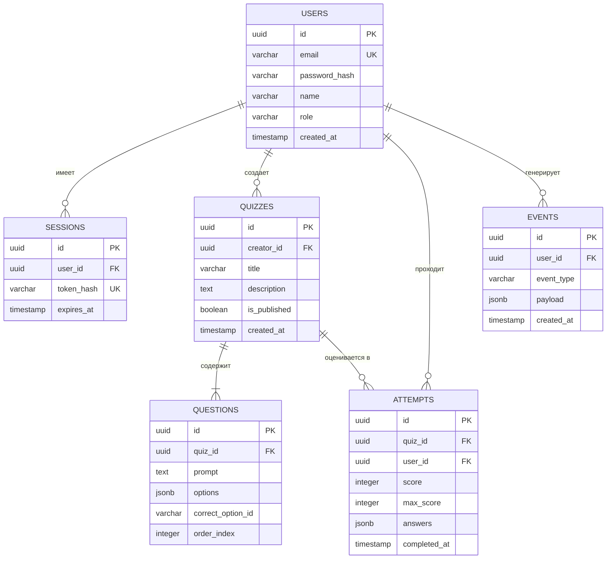
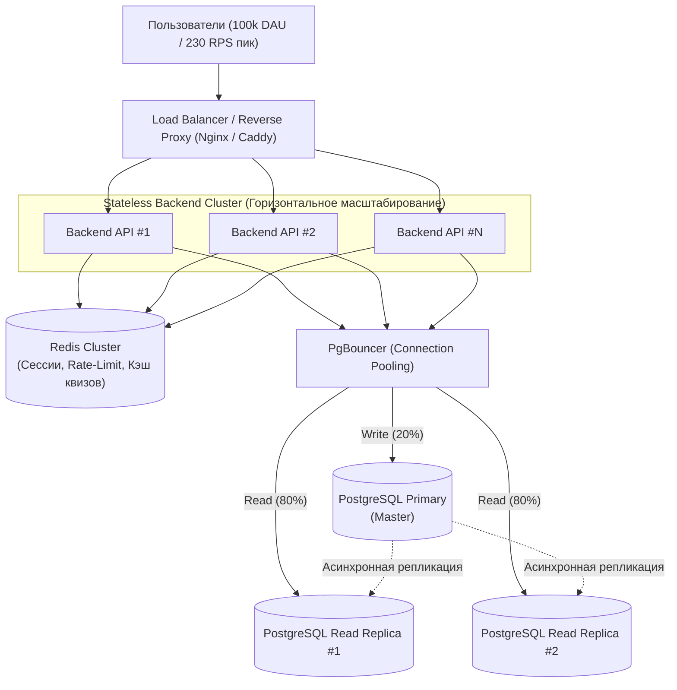

# Quizy — Платформа для создания и прохождения интерактивных викторин

## Состав команды

* **Драй Мохамед Амин** — группа `5130904/40105`
* **Бочаров Егор Никитич** — группа `5130904/40105`
* **Харламов Кирилл Алексеевич** — группа `5130904/40105`

---

## Технологический стек

* **Frontend (UI):** React, TypeScript, Vite, Tailwind CSS, shadcn/ui
* **Backend:** Node.js, TypeScript, tRPC, Zod (валидация контрактов)
* **База данных:** PostgreSQL, Drizzle ORM (миграции и типобезопасные запросы)
* **Внешняя зависимость:** Open Trivia Database API (импорт готовых вопросов с защитой через паттерн *Circuit Breaker*)
* **Тестирование:** Vitest (модульные и интеграционные тесты)
* **Сборка и развертывание:** Docker, Docker Compose

---

## 1. Определение проблемы

Преподавателям, организаторам мероприятий и студентам сложно быстро организовывать интерактивные проверки знаний и викторины без громоздких систем управления обучением (LMS), требующих долгой настройки. При этом составление качественных вопросов с нуля отнимает много времени, а при ручном проведении опросов отсутствует мгновенная автоматическая проверка ответов и аналитика результатов в реальном времени.

---

## 2. Выработка требований

### Пользовательские истории (User Stories)

1. **Создание и наполнение викторины (Организатор / Преподаватель):**
   **Когда** мне нужно быстро подготовить проверочный тест или развлекательную викторину, **я хочу** создать квиз в конструкторе и импортировать часть вопросов из внешнего банка по нужной теме и сложности, **чтобы** сэкономить время на ручном составлении заданий.
2. **Прохождение викторины и мгновенная оценка (Участник / Студент):**
   **Когда** я прохожу назначенную викторину с мобильного устройства или компьютера, **я хочу** отправлять ответы в удобном интерфейсе и сразу получать итоговый балл и разбор результатов, **чтобы** моментально оценить свой уровень знаний.
3. **Мониторинг активности и результатов (Организатор / Преподаватель):**
   **Когда** участники завершают прохождение викторины, **я хочу** видеть статистику попыток, статусы прохождения и журнал событий в панели управления, **чтобы** объективно оценивать успеваемость группы.

### Оценка аудитории и срока хранения данных

* **Целевая аудитория:** $10\,000$ активных пользователей в сутки (DAU).
* **Пиковая активность:** до $1\,500$ одновременных пользователей в часы проведения учебных занятий и мероприятий.
* **Период хранения данных:** $7\text{ лет}$ ($> 5\text{ лет}$), что покрывает полный цикл обучения бакалавриата и магистратуры, а также позволяет хранить историю прохождений и аналитику.

---

## 3. Разработка архитектуры и детальное проектирование

### 3.1. Характер нагрузки на сервис

#### Соотношение Read / Write (R/W)
* **Чтение (Read) — ~80%:** загрузка списка доступных викторин, получение вопросов при прохождении, просмотр дашборда и истории результатов.
* **Запись (Write) — ~20%:** регистрация и аутентификация, создание/редактирование викторин, сохранение ответов и результатов попыток, запись событий аудита.

#### Расчет объемов трафика
Исходим из того, что каждый из $10\,000$ пользователей в сутки в среднем совершает $20$ запросов к API:
* **Общее количество запросов в сутки:**
  $$10\,000 \times 20 = 200\,000\text{ запросов/сутки}$$
* **Средний RPS (запросов в секунду):**
  $$\frac{200\,000}{86\,400} \approx 2.3\text{ RPS}$$
* **Пиковый RPS** (с учетом коэффициента неравномерности $\times 10$ во время начала пар/квизов):
  $$2.3 \times 10 \approx 23\text{ RPS}$$
* **Объем сетевого трафика:**
  * Средний размер ответа API (JSON с вопросами или результатами) — $\approx 4\text{ КБ}$.
  * Суточный исходящий трафик API: $200\,000 \times 4\text{ КБ} \approx 800\text{ МБ/сутки}$ ($\approx 24\text{ ГБ/месяц}$).
  * Пиковая полоса пропускания: $23\text{ RPS} \times 4\text{ КБ} \approx 92\text{ КБ/с}$ ($\approx 0.74\text{ Мбит/с}$).

#### Расчет объемов дисковой системы (на 7 лет)
Предположим, что в сутки создается $200$ новых викторин (по $10$ вопросов в каждой) и фиксируется $15\,000$ прохождений (попыток):
* **Пользователи:** $100\,000$ записей за 7 лет $\times 500\text{ Б} \approx 50\text{ МБ}$.
* **Викторины и вопросы:** $200 \times 365 \times 7 \approx 511\,000$ викторин $\times 5\text{ КБ} \approx 2.55\text{ ГБ}$.
* **Результаты прохождений и ответы:** $15\,000 \times 365 \times 7 \approx 38.3\text{ млн}$ записей $\times 1\text{ КБ} \approx 38.3\text{ ГБ}$.
* **Журнал событий (Events / Logs):** $50\,000 \times 365 \times 7 \approx 127.7\text{ млн}$ записей $\times 300\text{ Б} \approx 38.3\text{ ГБ}$.
* **Итого «сырых» данных за 7 лет:** $\approx 79.2\text{ ГБ}$.
* **С учетом индексов PostgreSQL (+30%) и запаса под WAL/бэкапы:** требуется дисковая подсистема объемом **$\ge 150\text{ ГБ}$** (NVMe SSD).

---

### 3.2. Архитектурные диаграммы (C4 Model)

#### Уровень 1: System Context Diagram (Диаграмма контекста)



#### Уровень 2: Container Diagram (Диаграмма контейнеров)



---

### 3.3. Контракты API и нефункциональные требования (NFR)

Взаимодействие клиента и сервера построено на **tRPC** поверх HTTP с валидацией входных и выходных схем через **Zod** (`app/contracts/schemas.ts`).

| Процедура / Эндпоинт | Тип | Входные данные (Request) | Выходные данные (Response) | Ожидаемый NFR (p95) |
| :--- | :--- | :--- | :--- | :--- |
| `auth.register` / `auth.login` | Mutation | `{ email, password, name? }` | `{ user: { id, email, name }, sessionCookie }` | $\le 250\text{ мс}$ (хеширование пароля) |
| `quiz.list` | Query | `{ limit?, offset?, search? }` | `{ items: QuizSummary[], total: number }` | $\le 80\text{ мс}$ |
| `quiz.getById` | Query | `{ id: string }` | `{ id, title, description, questions: Question[] }` | $\le 80\text{ мс}$ |
| `quiz.create` | Mutation | `{ title, description, questions: CreateQuestionInput[] }` | `{ id, createdAt }` | $\le 150\text{ мс}$ |
| `quiz.submitAttempt` | Mutation | `{ quizId, answers: Record<questionId, optionId> }` | `{ attemptId, score, maxScore, breakdown[] }` | $\le 150\text{ мс}$ |
| `trivia.importQuestions` | Query | `{ amount: number, category?, difficulty? }` | `{ questions: ImportedQuestion[] }` | $\le 800\text{ мс}$ (внешнее API + таймаут) |
| `events.list` / `students.stats` | Query | `{ quizId?, dateRange? }` | `{ events: AuditEvent[], stats: StudentMetric[] }` | $\le 120\text{ мс}$ |

**Дополнительные нефункциональные требования:**
* **Доступность (Availability):** $99.5\%$ в учебное время.
* **Отказоустойчивость:** при недоступности внешнего `Open Trivia DB API` срабатывает *Circuit Breaker* (`app/api/services/circuit-breaker.ts`), предотвращая каскадные таймауты основного сервера.
* **Защита от перегрузок:** встроенный *Rate Limiter* (`app/api/lib/rate-limit.ts`) ограничивает частоту запросов с одного клиента.

---

### 3.4. Схема базы данных и обоснование соответствия NFR

Схема реляционной БД реализована в PostgreSQL (`app/db/schema.ts`):



#### Почему выбранная схема БД выдержит нефункциональные требования:
1. **Низкая пиковая нагрузка относительно возможностей PostgreSQL:** пиковые $23\text{ RPS}$ с запасом укладываются в пропускную способность одного инстанса PostgreSQL (который способен обрабатывать тысячи простых OLTP-запросов в секунду на SSD).
2. **Оптимизация чтения вопросов (`JSONB` для вариантов ответа):** варианты ответов хранятся в колонке `options` типа `JSONB` внутри таблицы `QUESTIONS`. Это избавляет от лишних `JOIN` при загрузке викторины и позволяет отдавать весь тест за один индексный поиск по `quiz_id` за $< 10\text{ мс}$.
3. **Индексирование горячих путей:** созданы B-Tree индексы по внешним ключам (`questions.quiz_id`, `attempts.quiz_id`, `attempts.user_id`, `sessions.token_hash`), что гарантирует выполнение запросов проверки сессии и выборки статистики без полного сканирования таблиц (Seq Scan) даже при накоплении десятков миллионов записей за 7 лет.
4. **Партиционирование исторических данных:** таблицы `ATTEMPTS` и `EVENTS` имеют поле `created_at` / `completed_at`, что позволяет при росте объема данных включить декларативное партиционирование по годам без изменения кода приложения.

---

### 3.5. Схема масштабирования при росте нагрузки в 10 раз

При увеличении аудитории в $10$ раз (**$100\,000\text{ DAU}$**, **$\approx 230\text{ RPS}$ в пике**, объем БД **$\approx 800\text{ ГБ} - 1\text{ ТБ}$** за 7 лет) архитектура масштабируется горизонтально без переписывания бизнес-логики:



**Ключевые изменения при $10\times$ росте нагрузки:**
1. **Балансировка и Stateless-реплики Backend API:** приложение не хранит состояние в оперативной памяти процесса, поэтому запускается $3\text{–}5$ экземпляров Node.js-сервера за балансировщиком нагрузки (Nginx).
2. **Вынос кэша, сессий и Rate Limiter в Redis:** счетчики ограничений запросов и горячие опубликованные викторины кэшируются в Redis (TTL 5–10 минут), что снимает до $70\%$ нагрузки на чтение с основной БД.
3. **Разделение R/W потоков БД (Primary + Read Replicas) и PgBouncer:** поскольку $80\%$ нагрузки приходится на чтение, запросы выборки квизов и аналитики направляются на Read-реплики PostgreSQL, а пулер соединений `PgBouncer` защищает БД от исчерпания лимита подключений при росте числа инстансов API.

---

## 4. Тестирование

В проекте реализованы два уровня автоматизированного тестирования на базе **Vitest**:

### Модульное тестирование (Unit Tests)
Проверяет изолированную бизнес-логику и граничные случаи:
* `app/api/services/grader.test.ts` — проверка алгоритма подсчета баллов, обработки частичных и пустых ответов.
* `app/api/services/circuit-breaker.test.ts` — проверка переходов состояний (`CLOSED` $\rightarrow$ `OPEN` $\rightarrow$ `HALF_OPEN`) при сбоях внешнего API.
* `app/api/services/trivia.test.ts` — проверка парсинга, декодирования и нормализации вопросов из внешнего источника.
* `app/api/lib/password.test.ts` — проверка криптографического хеширования и верификации паролей.
* `app/contracts/schemas.test.ts` — проверка валидации входных контрактов Zod.

### Интеграционное тестирование (Integration Tests)
* `app/api/quizzy.integration.test.ts` (конфигурация `app/vitest.integration.config.ts`) — сквозной сценарий, покрывающий пользовательскую историю от регистрации пользователя и создания викторины до ее прохождения и проверки итоговой оценки в базе данных.

---

## 5. Сборка и запуск проекта

Проект полностью контейнеризован и запускается через **Docker Compose** (конфигурация находится в директории `app/`).

### Запуск через Docker Compose

1. Перейдите в директорию с конфигурацией приложения:
   ```bash
   cd app
   ```
2. Запустите сборку и старт контейнеров (PostgreSQL + Backend/Frontend):
   ```bash
   docker compose up --build -d
   ```
3. Приложение будет доступно в браузере по адресу: `http://localhost:3000` (или порту, указанному в `app/docker-compose.yml`).

### Локальный запуск тестов

```bash
cd app
npm install

# Запуск модульных тестов
npm test

# Запуск интеграционных тестов
npx vitest run --config vitest.integration.config.ts
```
