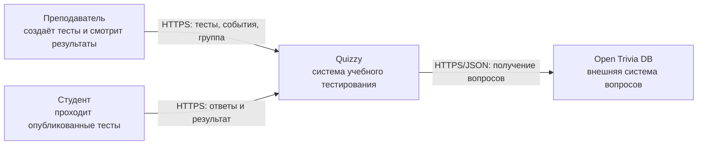
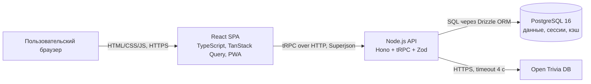
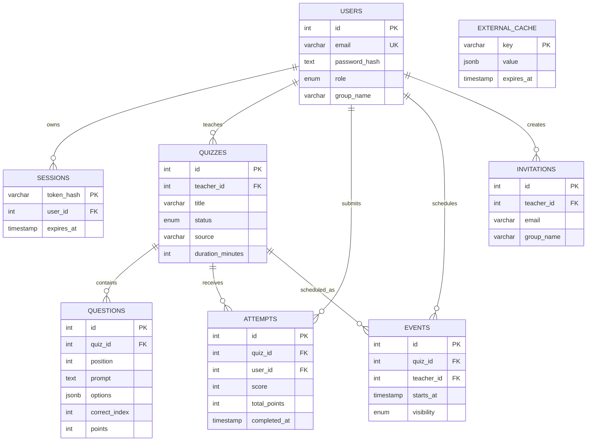

# Quizzy — платформа для создания и прохождения тестов

Quizzy — клиент-серверное веб-приложение для преподавателей и студентов. Преподаватель создаёт тесты вручную или импортирует вопросы из Open Trivia DB, публикует их, планирует занятия и видит результаты. Студент проходит опубликованные тесты, а результат рассчитывается и сохраняется на сервере.

Этот `README.md` одновременно является инструкцией по запуску и отчётом по курсовой работе «Конструирование программного обеспечения».

## 1. Сведения о проекте и команде

| Поле | Значение |
|---|---|
| Тема | Разработка клиент-серверной платформы для проведения учебного тестирования |
| Репозиторий | `<URL публичного GitHub-репозитория>` |
| Участник | `<ФИО>` |
| Группа | `<номер группы>` |
| Преподаватель | Юркин В. А. |
| Год | 2026 |

Перед сдачей необходимо заменить поля в угловых скобках и добавить ссылку на GitHub Projects. Данные демонстрационных пользователей не являются реальными персональными данными.

## 2. Этап 1 — проблема и границы продукта

**Проблема.** Преподавателю трудно быстро подготовить проверку знаний, собрать ответы группы и увидеть результаты без ручной обработки таблиц. Студенту нужен понятный способ пройти тест и сразу получить объективный результат.

**Решение.** Единая система хранит пользователей, тесты, вопросы, расписание и попытки в PostgreSQL. Сервер контролирует роли и правильность ответов, поэтому браузер не является источником истины.

### Реализованные возможности

- регистрация, вход и выход по HTTP-only сессии;
- роли `teacher` и `student` с проверкой прав на сервере;
- создание и редактирование теста с динамическим списком вопросов;
- черновики и публикация, поиск и фильтрация библиотеки;
- импорт вопросов из открытого Open Trivia DB с предварительным просмотром;
- прохождение теста с таймером, пропуском вопросов и серверной оценкой;
- история попыток и агрегированные показатели;
- события и приглашения студентов;
- редактирование профиля, адаптивный интерфейс и PWA-манифест.

Приглашения сохраняются в системе, но отправка письма намеренно не имитируется: SMTP-сервис не подключён, интерфейс прямо сообщает об этом.

## 3. Этап 2 — пользовательские сценарии и требования

### User Story 1. Подготовка теста

**Как** преподаватель, **я хочу** создать тест из нескольких вопросов и опубликовать его, **чтобы** студенты могли проверить свои знания.

Критерии приёмки:

1. У вопроса есть от двух до шести непустых уникальных вариантов.
2. Правильный вариант существует, баллы и время прохождения положительны.
3. Черновик недоступен студенту; опубликованный тест виден в его библиотеке.
4. Другой преподаватель не может изменить или удалить чужой тест.

### User Story 2. Импорт вопросов

**Как** преподаватель, **я хочу** получить вопросы из открытого каталога, **чтобы** не вводить повторяющийся учебный материал вручную.

Критерии приёмки:

1. Можно выбрать количество и сложность, затем проверить результат до сохранения.
2. HTML-сущности декодируются, правильный ответ сохраняется корректно после перемешивания.
3. Импорт сохраняется как редактируемый тест с источником `opentdb`.
4. При сбое внешнего API используется свежий или устаревший кэш либо возвращается понятная ошибка.

### User Story 3. Прохождение теста

**Как** студент, **я хочу** отвечать на вопросы и пропускать неизвестные, **чтобы** получить результат за ограниченное время.

Критерии приёмки:

1. Студент получает варианты без `correctIndex` и без пояснения правильного ответа.
2. Можно явно пропустить вопрос; после истечения времени неотвеченные вопросы считаются пропущенными.
3. Сервер отклоняет неизвестные и повторные ID вопросов, неполный и выходящий за диапазон ответ.
4. Баллы, число правильных ответов и время попытки сохраняются в PostgreSQL.

### User Story 4. Контроль группы

**Как** преподаватель, **я хочу** видеть результаты и приглашения своей группы, **чтобы** понимать учебную динамику.

Критерии приёмки: средний балл студента рассчитывается только по тестам текущего преподавателя; удаление приглашения также ограничено его владельцем.

## 4. Технологический стек

| Слой | Технологии и причина выбора |
|---|---|
| Frontend | React 19, TypeScript, Vite, Tailwind CSS, React Hook Form |
| Проверка данных | Zod 4: одни контракты используются формами и сервером |
| API | Hono, tRPC 11, Superjson: типобезопасные вызовы без дублирования DTO |
| Клиентские запросы | TanStack Query через tRPC React client |
| Backend | Node.js 22, строгий TypeScript |
| База данных | PostgreSQL 16, Drizzle ORM, `node-postgres`, SQL-миграции |
| Безопасность | `scrypt`, случайные сессионные токены, SHA-256 хэш токена, HTTP-only cookie |
| Внешняя интеграция | Open Trivia DB, Zod-валидация ответа, кэш, timeout, Circuit Breaker |
| Тесты | Vitest, отдельная база `quizzy_test`, реальные SQL-миграции |
| Эксплуатация | Docker, Docker Compose, GitHub Actions, логирование в STDOUT |

## 5. Воспроизводимый запуск

### 5.1. Одна команда через Docker Compose

Требуются только Docker с Compose и Bash. Node.js и PostgreSQL на хост устанавливать не нужно.

```bash
docker compose up --build
```

Что происходит автоматически:

1. Запускается PostgreSQL 16 и создаются базы `quizzy` и изолированная `quizzy_test`.
2. Health check базы блокирует запуск приложения до готовности PostgreSQL.
3. Выполняются SQL-миграции из `db/migrations`.
4. Идемпотентно добавляются демонстрационные пользователи и тест.
5. Собираются React-клиент и Node.js-сервер; приложение открывается на **http://localhost:3000**.

Демонстрационные аккаунты:

| Роль | Email | Пароль |
|---|---|---|
| Преподаватель | `teacher@quizzy.dev` | `Teacher123` |
| Студент | `student@quizzy.dev` | `Student123` |

Данные PostgreSQL сохраняются в volume `quizzy-postgres`. Другой порт можно задать через `APP_PORT`, например `APP_PORT=8080 docker compose up --build`.

### 5.2. Изолированные тесты в контейнере

```bash
docker compose --profile test run --rm test
```

Контейнер применяет миграции к `quizzy_test`, не заполняет её демонстрационными данными и выводит отчёт Vitest. Интеграционные тесты отказываются работать с базой, имя которой не заканчивается на `_test`, и очищают только тестовые таблицы.

### 5.3. Локальная разработка

Нужны Node.js 22 и PostgreSQL 16:

```bash
cp .env.example .env
npm ci
npm run db:migrate
npm run db:seed
npm run dev
```

Для локальных тестов создайте `quizzy_test` с тем же пользователем. При необходимости задайте `TEST_DATABASE_URL`; переменная имеет приоритет над `DATABASE_URL`.

Полезные команды:

```bash
npm run check          # строгая проверка TypeScript
npm run test:unit      # бизнес-правила без базы данных
npm run test:integration
npm test               # оба набора
npm run build          # production-сборка клиента и сервера
npm run db:generate    # новая миграция после изменения схемы
```

## 6. Этап 3 — архитектура

### 6.1. C4 Level 1: System Context



### 6.2. C4 Level 2: Containers



SPA отвечает только за представление и клиентскую валидацию. Повторная Zod-валидация на сервере обязательна, поскольку клиент может быть изменён. API stateless на уровне приложения: сессия и кэш находятся в PostgreSQL, поэтому экземпляры можно заменять и масштабировать горизонтально.

### 6.3. Структура исходного кода

```text
api/                 Hono, tRPC routers и бизнес-сервисы
  services/          оценка, тесты, внешний API, Circuit Breaker
  lib/               пароли, сессии, окружение, STDOUT-логи
contracts/           общие Zod-схемы и типы
db/                  Drizzle-схема, миграции, demo seed
src/
  components/        оболочка, состояния, диалоги, импорт
  pages/             страницы маршрутов
  providers/         tRPC и аутентификация
scripts/             entrypoint контейнера
.github/workflows/   CI
```

## 7. Контракты API и нефункциональные требования

Все процедуры доступны по `/api/trpc/<procedure>`. Query использует GET, mutation — POST; данные кодируются Superjson. Входные данные описаны Zod-схемами в `contracts/schemas.ts`. Ошибки возвращаются как стандартные tRPC errors: `UNAUTHORIZED`, `FORBIDDEN`, `NOT_FOUND`, `CONFLICT`, `BAD_REQUEST` или `INTERNAL_SERVER_ERROR`.

| Процедура | Метод | Доступ | Назначение |
|---|---|---|---|
| `auth.register` | POST | Все | Регистрация и создание сессии |
| `auth.login` | POST | Все | Вход; общий текст ошибки не раскрывает наличие email |
| `auth.logout` | POST | Все | Удаление серверной сессии |
| `auth.me` | GET | Все | Текущий безопасный профиль или `null` |
| `quiz.dashboard` | GET | Авторизован | Метрики и ближайшие данные |
| `quiz.list` | GET | Авторизован | Свои тесты преподавателя / опубликованные тесты студента |
| `quiz.get` | GET | Авторизован | Тест; студенту не передаются правильные ответы |
| `quiz.create` | POST | Teacher | Транзакционное создание теста и вопросов |
| `quiz.createFromTrivia` | POST | Teacher | Сохранение импортированного теста |
| `quiz.update` | POST | Teacher, владелец | Транзакционная замена содержимого |
| `quiz.remove` | POST | Teacher, владелец | Каскадное удаление теста |
| `quiz.submit` | POST | Авторизован | Проверка целостности, оценка и сохранение попытки |
| `quiz.attempts` | GET | Teacher, владелец | Последние результаты по тесту |
| `trivia.fetch` | POST | Teacher | Вопросы из сети, кэша или stale cache |
| `event.list/create/update/remove` | GET/POST | По роли | Расписание с контролем владельца |
| `students.list/invite/removeInvitation` | GET/POST | Teacher | Группа, показатели и приглашения |
| `profile.update` | POST | Авторизован | Имя и учебная группа |
| `GET /api/health` | GET | Все | Health check контейнера |

### Целевые NFR

| Показатель | Цель и способ контроля |
|---|---|
| API latency | p95 ≤ 300 мс для операций с локальной БД при расчётной нагрузке |
| Аутентификация | p95 ≤ 700 мс из-за намеренно ресурсоёмкого `scrypt` |
| Внешний импорт | timeout 4 с; p95 ≤ 4,5 с без кэша, p95 ≤ 300 мс при cache hit |
| Доступность | 99,9 % для основного сценария; недоступность Open Trivia DB не останавливает ручные тесты |
| Целостность | внешние ключи, транзакции создания/редактирования, серверная оценка |
| Безопасность | только хэши паролей и токенов; роли и владение проверяются на сервере |
| Логи | JSON в STDOUT с method/path/status/duration/requestId, без секретов |
| UI | адаптивность от 375 px, keyboard focus, reduced motion, отсутствие неработающих кнопок |

Для учебного проекта цели NFR зафиксированы как проектные требования. Для промышленной приёмки их нужно подтвердить нагрузочным тестированием k6/Gatling и мониторингом гистограмм latency; настоящий README не выдаёт синтетические замеры за production SLA.

## 8. Проектирование данных

### 8.1. ER-диаграмма



### 8.2. Обоснование структуры

- Нормализация отделяет стабильные метаданные теста от переменного числа вопросов. Это исключает массивы повторяющихся групп и упрощает оценку.
- Варианты ответа — небольшой упорядоченный список, поэтому `jsonb` уместен: не требуются запросы к отдельным вариантам, а весь вопрос читается одной строкой.
- В попытке хранится вычисленный результат, а не ответы браузера. Это компактно и достаточно для текущей аналитики. Для подробного разбора ответов в следующей версии добавляется таблица `attempt_answers`.
- Внешние ключи и `ON DELETE CASCADE` не оставляют вопросы, сессии и попытки без родительской сущности.
- PostgreSQL enum ограничивает роли, статусы и сложность на уровне БД; Zod проверяет их раньше, на границе API.
- Создание теста и замена вопросов выполняются в транзакциях: частично сохранённый тест невозможен.

### 8.3. Индексы и запросы

| Индекс | Запрос, который он поддерживает |
|---|---|
| `users.email` unique | Вход и запрет дубликатов аккаунта |
| `sessions.token_hash` PK | Проверка каждой сессии без сканирования |
| `sessions_expiry_idx` | Очистка истёкших сессий |
| `quizzes_teacher_status_idx` | Библиотека владельца и фильтр публикации |
| `questions_quiz_position_idx` | Чтение вопросов теста в нужном порядке |
| `attempts_quiz_user_idx` | Результаты теста и попытки пользователя |
| `events_start_idx` | Ближайшие события по времени |
| `invitations_teacher_idx` | Приглашения текущего преподавателя |
| `external_cache.key` PK | O(log N) доступ к кэшу по параметрам внешнего запроса |

Списки ограничены 100 записями, история — 20. При росте таблицы `attempts` добавляется отдельный индекс `(user_id, completed_at DESC)` и пагинация по курсору. Составные индексы соответствуют реальным предикатам, а не создаются на каждый столбец без необходимости.

## 9. Отказоустойчивость внешней зависимости

Интеграция находится в `api/services/trivia.ts`.

1. Ключ кэша включает количество и сложность: `trivia:<amount>:<difficulty>`.
2. Свежая запись PostgreSQL возвращается без обращения к Open Trivia DB; TTL — 6 часов.
3. Сетевой вызов ограничен `AbortSignal.timeout(4000)`, а JSON проверяется Zod. Ненулевой `response_code` считается ошибкой.
4. Circuit Breaker открывается после трёх последовательных ошибок и на 30 секунд прекращает новые вызовы внешнего API. После cooldown допускается пробный вызов; успех сбрасывает счётчик.
5. При сетевой ошибке, timeout, невалидном JSON или открытом breaker возвращается устаревший кэш с маркером `stale`.
6. Если кэша нет, пользователь получает управляемую ошибку. Создание теста вручную, прохождение тестов и результаты продолжают работать.

Таким образом внешняя зависимость влияет только на импорт новых вопросов. Кэш также снижает число запросов и риск блокировки со стороны открытого API. В Docker-среде кэш переживает перезапуск приложения, поскольку находится в PostgreSQL, а не в памяти процесса.

## 10. Capacity Planning: 10 000 уникальных пользователей в сутки

Оценка высокоуровневая: это не обещание производительности конкретного сервера, а модель для выбора архитектуры и запаса ресурсов.

### 10.1. Исходные допущения

- 10 000 DAU: 9 500 студентов и 500 активных преподавателей.
- Студент выполняет 25 read- и 3 write-операции в день; преподаватель — 60 read и 15 write.
- Средний read response — 8 КБ; write request вместе с response — 4 КБ. Используются десятичные КБ/ГБ.
- Пиковый коэффициент равен 10 относительно средней нагрузки.
- На один тест приходится в среднем 10 вопросов; создаётся 100 тестов и 50 событий в день.
- Студенты выполняют в среднем одну попытку в день; новых пользователей — 5 000 в год.
- Сессии старше семи дней регулярно удаляются, поэтому не накапливаются пять лет.

### 10.2. Read/Write и RPS

| Показатель | Расчёт | Результат |
|---|---:|---:|
| Read в сутки | 9 500 × 25 + 500 × 60 | 267 500 |
| Write в сутки | 9 500 × 3 + 500 × 15 | 36 000 |
| Всего API-запросов | 267 500 + 36 000 | 303 500 |
| Доля read / write | 88,1 % / 11,9 % | **≈ 7,4 : 1** |
| Средний RPS | 303 500 / 86 400 | 3,51 |
| Пиковый RPS | 3,51 × 10 | **35,1** |

Один небольшой Node.js-инстанс и PostgreSQL с connection pool достаточны как начальная конфигурация для такого RPS, но итоговый размер CPU/RAM определяется нагрузочным тестом. `scrypt` выделяется отдельно: лимитер 20 попыток входа/регистрации за 15 минут на IP и действие снижает риск исчерпания CPU.

### 10.3. Сетевой трафик

| Поток | Расчёт | Объём |
|---|---:|---:|
| API read | 267 500 × 8 КБ | 2,14 ГБ/сутки |
| API write | 36 000 × 4 КБ | 0,144 ГБ/сутки |
| API итого | 2,14 + 0,144 | **2,284 ГБ/сутки**, ≈ 68,5 ГБ/30 дней |
| Статика при 30 % некэшированных визитов | 3 000 × 0,35 МБ | 1,05 ГБ/сутки |
| С запасом на статику | 2,284 + 1,05 | **≈ 3,34 ГБ/сутки**, ≈ 100 ГБ/30 дней |

Пиковая полоса только для API: `35,1 × 8 КБ ≈ 281 КБ/с ≈ 2,25 Мбит/с`; с учётом статики, TLS и всплесков закладывается минимум 10 Мбит/с. PWA и HTTP-кэширование уменьшают повторную загрузку клиентских ресурсов; API-ответы с результатами не кэшируются браузером.

### 10.4. Диск на шесть лет (> 5 лет)

| Данные | Допущение и расчёт | Объём/год |
|---|---:|---:|
| Попытки | 9 500 × 365 × 0,25 КБ | 868 МБ |
| Тесты и вопросы | 100 × 365 × (0,5 + 10 × 0,8) КБ | 310 МБ |
| Пользователи | 5 000 × 0,6 КБ | 3 МБ |
| События | 50 × 365 × 0,2 КБ | 4 МБ |
| **Рост пользовательских данных** | сумма | **≈ 1,185 ГБ/год** |
| **За шесть лет** | 1,185 × 6 | **≈ 7,11 ГБ** |

С учётом индексов, служебных структур, свободного места и временного роста принят коэффициент 2: **около 14,2 ГБ за шесть лет**. Активный набор сессий и внешний кэш ограничены по времени и не меняют порядок оценки. Рекомендуемый стартовый диск — 100 ГБ: этого достаточно для данных, WAL, локальных операций обслуживания и запаса. Резервные копии и долгосрочные логи хранятся отдельно; их размер не смешивается с размером основной БД.

## 11. Масштабирование до 100 000 DAU

При сохранении модели нагрузка вырастает в десять раз: **3 035 000 API-запросов/сутки**, средний 35,1 RPS, пик **351 RPS**, API-трафик около 22,84 ГБ/сутки. Рост БД — примерно 11,85 ГБ/год без индексов.

Стратегия по этапам:

1. **Stateless API:** минимум три экземпляра за reverse proxy/load balancer. Сессии уже вне процесса, поэтому липкие сессии не нужны.
2. **Соединения:** PgBouncer в transaction mode; ограниченный pool на каждом Node.js-инстансе, чтобы не исчерпать `max_connections` PostgreSQL.
3. **PostgreSQL:** сначала вертикальное масштабирование и NVMe, затем read replica для публичной библиотеки и аналитики. Запись остаётся на primary.
4. **Кэширование:** Redis для короткоживущих dashboard/list-ответов с инвалидацией после mutation. Кэш Open Trivia DB остаётся обязательным; его можно вынести в Redis с PostgreSQL как persistent fallback.
5. **Большие попытки:** курсорная пагинация, архивирование старых данных, а затем декларативное партиционирование `attempts` по `completed_at` после десятков миллионов строк.
6. **Фоновые задачи:** очистка сессий и тяжёлая аналитика выносятся из request path в worker/scheduler.
7. **Наблюдаемость:** Prometheus/OpenTelemetry, RED-метрики, slow query log и алерты на p95, ошибки, глубину pool и открытый Circuit Breaker.

## 12. Этапы 4–5 — качество, тестирование и наблюдаемость

### Автоматические тесты

Текущий набор содержит **21 тест: 18 unit и 3 интеграционных сценария**.

| Набор | Что проверяется |
|---|---|
| `contracts/schemas.test.ts` | Нормализация email; слабые пароли; пустой тест; дубликаты вариантов; неверный correctIndex и лимит времени |
| `api/services/grader.test.ts` | Баллы, пропуски, неправильный ответ; неизвестные/повторные ID; неполный payload; выход за диапазон |
| `api/lib/password.test.ts` | Верный/неверный пароль, случайная соль, повреждённый хэш |
| `api/services/circuit-breaker.test.ts` | Открытие после ошибок, отсутствие лишнего вызова, восстановление после cooldown |
| `api/services/trivia.test.ts` | HTML entities и сохранение правильного ответа после перемешивания |
| `api/quizzy.integration.test.ts` | Полная история teacher → student, роли и владение, изоляция статистики, network/hit/stale cache |

Интеграционный тест не использует mock PostgreSQL: он применяет настоящие миграции к `quizzy_test`, регистрирует пользователей через tRPC, публикует тест, скрывает ответы студенту, сохраняет попытку и читает её преподавателем. Проверка `student.quiz.create` завершается `FORBIDDEN`, доступ к чужому тесту — `NOT_FOUND`.

### Логирование

Каждый API-запрос создаёт структурированную STDOUT-строку с методом, путём, HTTP-статусом, длительностью и `requestId`. Ошибки tRPC и необработанные исключения также выводятся в STDOUT. Docker не прячет логи внутри файла приложения:

```bash
docker compose logs -f app
```

Пароли, cookie и секреты в бизнес-логи не записываются. Для production STDOUT забирается платформой или агентом в централизованное хранилище.

### Проверки безопасности

- Пароль: Node.js `scrypt`, отдельная 128-битная соль, сравнение через `timingSafeEqual`.
- Сессия: 256-битный случайный opaque token; в БД только SHA-256 хэш; срок семь дней.
- Cookie: `HttpOnly`, `SameSite=Lax`, `Path=/`; `Secure` в production.
- Входные данные: серверные Zod-схемы, body limit, ограничение частоты login/register.
- Авторизация: middleware ролей и проверки владельца в каждом соответствующем сервисе.
- Оценка: выполняется на сервере; клиент не отправляет баллы и не получает правильный индекс.

## 13. Этап 6 — контейнеризация и CI

### Docker

`Dockerfile` использует multi-stage build: установка точных зависимостей по lockfile → TypeScript check и production build → минимальный runtime без исходников frontend. Приложение запускается не от root. `docker-entrypoint.sh` выполняет миграции и seed до запуска сервера.

`docker-compose.yml` содержит:

- `db` с health check и persistent volume;
- `app` с зависимостью от готовности БД и собственным `/api/health`;
- `test` под профилем `test`, использующий только `quizzy_test`.

Миграционные SQL-файлы включены в Git. Изменение схемы выполняется через `db/schema.ts` и `npm run db:generate`; миграции не перезаписываются вручную после генерации.

### GitHub Actions

Workflow `.github/workflows/ci.yml` запускается для push в `main` и каждого Pull Request:

1. Поднимает сервис PostgreSQL 16 с health check.
2. Выполняет `npm ci`.
3. Запускает `tsc -b`.
4. Запускает 18 unit и 3 PostgreSQL integration tests.
5. Собирает production bundle.
6. Отдельно проверяет сборку Docker image.

При красном CI Pull Request не должен объединяться. Для защиты `main` в GitHub рекомендуется включить required status check `verify` и хотя бы один review.

## 14. GitHub Issues, Projects и Pull Requests

Публичный репозиторий и проект создаются владельцем аккаунта; ссылки и имена участников не выдумываются в отчёте. После публикации репозитория необходимо оформить процесс так:

1. Создать GitHub Project с колонками **Todo → In Progress → In Review → Done**.
2. Завести отдельные Issues как минимум на требования, архитектуру, схему БД, API, UI, внешнюю интеграцию, тесты, Docker и CI.
3. Назначить каждому Issue responsible assignee и связать его с Project.
4. Для каждого участника создать собственную ветку, например `feature/quiz-builder`.
5. В PR указать `Closes #<номер>` и дождаться зелёного CI и ревью.
6. Перевести Issue в Done только после merge. Коммиты должны описывать законченные изменения, а не содержать серию `fix` без смысла.

Пример распределения для команды из двух человек:

| Участник | Ответственность |
|---|---|
| `<ФИО 1>` | Backend, PostgreSQL, интеграция, тестирование |
| `<ФИО 2>` | Frontend, UX, Docker/CI, архитектурная документация |

Для одиночной работы все Issues назначаются одному участнику, но история задач и PR всё равно сохраняется.

## 15. Соответствие заданию

| Требование | Где выполнено |
|---|---|
| PostgreSQL, Web UI, клиент-сервер | `db/`, `src/`, `api/`; C4 Container |
| Открытый внешний API | Open Trivia DB; `api/services/trivia.ts` |
| Минимум 3 user stories | Раздел 3 |
| Нагрузка от 10 000 DAU | Раздел 10 |
| Read/Write, сеть, диск > 5 лет | Разделы 10.2–10.4 |
| Fault Tolerance | Раздел 9 и тесты circuit breaker/cache |
| C4 Context и Container | Разделы 6.1–6.2 |
| API и latency/NFR | Раздел 7 |
| ER и обоснование индексов | Раздел 8 |
| Масштабирование до 100 000 DAU | Раздел 11 |
| STDOUT logging | `api/lib/logger.ts`, request middleware |
| GitHub Actions | `.github/workflows/ci.yml` |
| Модульные и интеграционные тесты | Раздел 12; `npm test` |
| Docker Compose одной командой | Раздел 5.1 |
| Изолированный запуск тестов | Раздел 5.2 |
| README как отчёт | Этот файл |
| Публичный GitHub, Issues, Projects, PR | Выполняется владельцем репозитория по разделу 14 |

## 16. Ограничения и дальнейшее развитие

- Приглашение пока является записью, а не отправленным письмом; для production требуется SMTP/provider.
- Доступ по share link требует входа; это осознанное поведение, исключающее анонимные попытки.
- Rate limiter и Circuit Breaker хранят состояние в памяти экземпляра. При горизонтальном масштабировании лимитер следует перенести в Redis; внешний кэш уже общий через PostgreSQL.
- Подробные ответы в попытке не сохраняются, только результат. Для аналитики по каждому ответу нужна отдельная нормализованная таблица и политика хранения.
- Перед реальным production-развёртыванием необходимы HTTPS, managed backups/PITR, мониторинг, секреты вне репозитория и нагрузочное подтверждение NFR.

Эти ограничения не мешают основному сквозному сценарию курсовой работы и явно отделены от уже реализованной функциональности.
